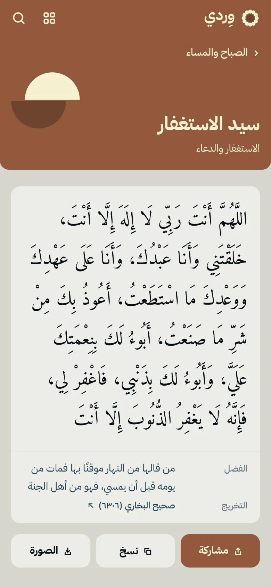

<p align="center">
  
</p>

<p align="center">
  <a href="https://wirdy.site"></a>
  <a href="LICENSE"></a>
</p>

Wirdy (وِردي) is the daily wird of a Muslim, taken only from what is authentic from the Prophet ﷺ. At [wirdy.site](https://wirdy.site), each dhikr carries its takhrij, linked to its hadith on [dorar.net](https://dorar.net/hadith). The site has no ads, no accounts, and no tracking, and no page makes a request to another site.

| Occasions | Adhkar | الطب النبوي | ما لم يثبت |
| --------: | -----: | ----------: | ---------: |
|         8 |    196 |          39 |         16 |

<p align="center">
  <picture>
    <source media="(prefers-color-scheme: dark)" srcset=".github/readme_screenshot_home_darkmode.webp">
    
  </picture>
  <picture>
    <source media="(prefers-color-scheme: dark)" srcset=".github/readme_screenshot_occasion_darkmode.webp">
    
  </picture>
  <picture>
    <source media="(prefers-color-scheme: dark)" srcset=".github/readme_screenshot_dhikr_darkmode.webp">
    
  </picture>
</p>

## Features

- **Eight occasions**, from الصباح والمساء to أحوال متفرقة, each on its own page.
- **Morning and evening forms.** The page shows the form for the time of day, and a switch changes it.
- **A page for each dhikr**, with buttons to share it, copy it with its count and takhrij, and save its card as an image.
- **Search** by name or by words, with or without diacritics.
- **[الطب النبوي](https://wirdy.site/al-tibb-al-nabawi/)**: the sound hadiths on treatment and keeping well.
- **[«ما لم يثبت»](https://wirdy.site/ma-lam-yathbut/)**: well-known adhkar that are not authentic, each with its ruling.

## What goes in

A dhikr is on the site only when dorar.net shows one of these:

1. It is in Sahih al-Bukhari or Sahih Muslim.
2. al-Albani grades it صحيح or حسن.

The rule covers its count and its time too. A dhikr that al-Albani grades ضعيف stays out, even when another scholar accepts it. [`verification/`](verification/) holds the proof of each checked dhikr: the text of the pages that prove it. [`docs/content.md`](docs/content.md) is the full standard.

The Quran text is the Uthmani text from [Tanzil](https://tanzil.net), in the riwayah of Hafs.

**Report a mistake.** If a word, a count, or a ruling is wrong, or an authentic dhikr is missing, [open a Dhikr correction](https://github.com/raaqimorg/wirdy/issues/new?template=dhikr-correction.yml). Give the dorar.net page that shows it.

## Run it locally

You need [Bun](https://bun.sh) 1.4 or later.

```bash
git clone https://github.com/raaqimorg/wirdy.git
cd wirdy
bun install
bun run dev
```

The site is then at http://localhost:4321. `bun install` also turns on the git hooks. [`docs/development.md`](docs/development.md) has every command.

## How it works

[Astro](https://astro.build) builds static HTML from Markdown, and [Cloudflare Pages](https://pages.cloudflare.com) serves it. The TypeScript is written with [Effect](https://effect.website). There is no client framework: each page has one small inline script, and search has one module.

| Part                                                               | Role                                                                 |
| ------------------------------------------------------------------ | -------------------------------------------------------------------- |
| [`src/content/adhkar/`](src/content/adhkar/)                       | One Markdown file for each dhikr: its text, count, time, and takhrij |
| [`src/content/tibb/`](src/content/tibb/)                           | The hadiths of الطب النبوي                                           |
| [`src/content/unproven/`](src/content/unproven/)                   | The entries of «ما لم يثبت», each with its ruling                    |
| [`src/lib/`](src/lib/)                                             | The schema and the logic, each file with its test                    |
| [`src/components/`](src/components/), [`src/styles/`](src/styles/) | The design system                                                    |
| [`src/pages/`](src/pages/)                                         | The routes                                                           |
| [`verification/`](verification/)                                   | The proof of each checked dhikr                                      |
| [`scripts/`](scripts/)                                             | The icon and card generators, and the verification tools             |

[`docs/README.md`](docs/README.md) is the index of the docs. [`AGENTS.md`](AGENTS.md) holds the rules for AI agents, and it is useful to anyone.

## Contributing

Report bugs and ideas in [GitHub issues](https://github.com/raaqimorg/wirdy/issues). To change code, do these steps:

1. Open an issue.
2. Fork the repo, and branch off `main`.
3. Run `bun run ci`.
4. Open a pull request into `main`, linked to the issue.

[`CONTRIBUTING.md`](.github/CONTRIBUTING.md) gives the full steps. [`docs/exceptions.md`](docs/exceptions.md) lists where the code is different from the usual approach, and why.

## Contact

[Raaqim](https://raaqim.org) maintains Wirdy, together with its contributors. Raaqim is an open-source organization behind several Arabic-language projects.

| For                                                              | Write to                                                                             |
| ---------------------------------------------------------------- | ------------------------------------------------------------------------------------ |
| Security reports, kept private ([policy](.github/SECURITY.md))   | [Report a vulnerability](https://github.com/raaqimorg/wirdy/security/advisories/new) |
| Conduct concerns ([code of conduct](.github/CODE_OF_CONDUCT.md)) | conduct@raaqim.org                                                                   |

## License

The code and documentation are under the [MIT license](LICENSE). The adhkar are the words of the Prophet ﷺ, and belong to no one. The Quran text is under [Tanzil's terms](NOTICE), not under MIT: copy it as it is, and do not change it.

The site uses the [Amiri](https://github.com/aliftype/amiri), Amiri Quran, and [IBM Plex Sans Arabic](https://github.com/IBM/plex) typefaces under the [SIL Open Font License 1.1](https://openfontlicense.org). The design follows [Laws of UX](https://lawsofux.com/) by Jon Yablonski. The code of conduct is adapted from the [Contributor Covenant](https://www.contributor-covenant.org) 2.1.
