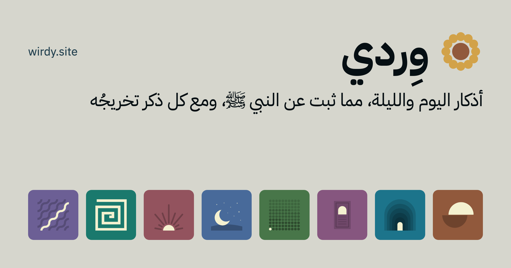

<p align="center">
  
</p>

<p align="center">
  <a href="https://wirdy.site"></a>
  <a href="LICENSE"></a>
</p>

The daily adhkar authentic from the Prophet ﷺ, in eight occasions. Each dhikr links to its hadith on [dorar.net](https://dorar.net/hadith).

<p align="center">
  <picture>
    <source media="(prefers-color-scheme: dark)" srcset=".github/readme_screenshot_home_darkmode.webp">
    
  </picture>
  <picture>
    <source media="(prefers-color-scheme: dark)" srcset=".github/readme_screenshot_occasion_darkmode.webp">
    
  </picture>
  <picture>
    <source media="(prefers-color-scheme: dark)" srcset=".github/readme_screenshot_dhikr_darkmode.webp">
    
  </picture>
</p>

## What goes in

A dhikr is in Sahih al-Bukhari or Sahih Muslim, or al-Albani grades it صحيح or حسن, with its count and its time. [`docs/content.md`](docs/content.md) has the full standard.

Found a mistake? [Open a Dhikr correction](https://github.com/raaqimorg/wirdy/issues/new?template=dhikr-correction.yml).

## Development

```bash
bun install
bun run dev   # http://localhost:4321
bun run ci    # before a pull request
```

See [`CONTRIBUTING.md`](.github/CONTRIBUTING.md) and [`docs/`](docs/README.md).

## License

The code is [MIT](LICENSE). The Quran text is under [Tanzil's terms](NOTICE). The fonts are under the SIL Open Font License 1.1.

Maintained by [Raaqim](https://raaqim.org).
