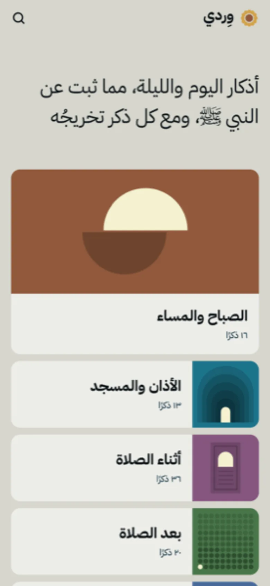
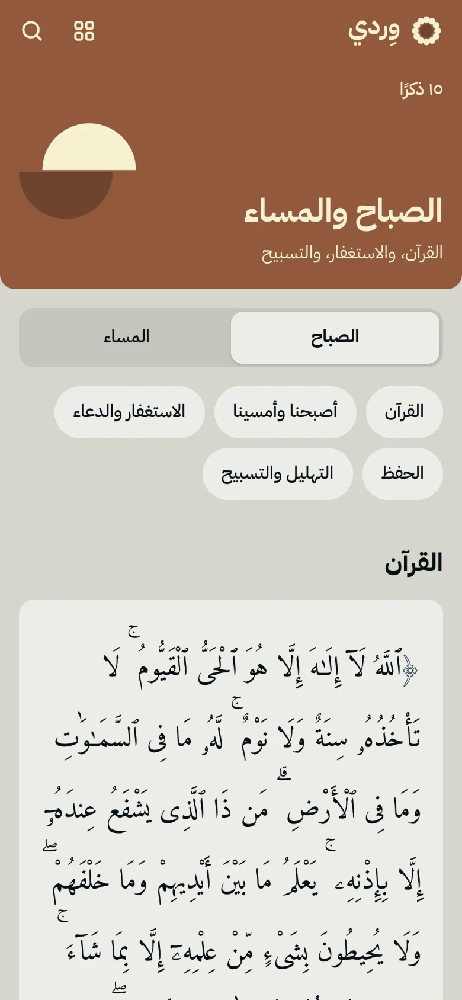

<p align="center">
  
</p>

<p align="center">
  <a href="https://wirdy.site"></a>
  <a href="LICENSE"></a>
</p>

Wirdy (وِردي) is a site of the daily adhkar that are authentic from the Prophet ﷺ. Each dhikr links to its hadith on [dorar.net](https://dorar.net/hadith). No ads, no accounts, no tracking.

| Occasions | Adhkar | الطب النبوي | ما لم يثبت |
| --------: | -----: | ----------: | ---------: |
|         8 |    196 |          39 |         16 |

<p align="center">
  <picture>
    <source media="(prefers-color-scheme: dark)" srcset=".github/readme_screenshot_home_darkmode.webp">
    
  </picture>
  <picture>
    <source media="(prefers-color-scheme: dark)" srcset=".github/readme_screenshot_occasion_darkmode.webp">
    
  </picture>
  <picture>
    <source media="(prefers-color-scheme: dark)" srcset=".github/readme_screenshot_dhikr_darkmode.webp">
    
  </picture>
</p>

## Features

- Eight occasions, each on its own page.
- Morning and evening forms. The page shows the morning before noon and the evening after, and a switch changes it.
- A page for each dhikr. Share it, copy it with its count and takhrij, or save its card as an image.
- Search across the whole site, with or without diacritics.
- [الطب النبوي](https://wirdy.site/al-tibb-al-nabawi/): the sound hadiths on treatment and keeping well.
- [«ما لم يثبت»](https://wirdy.site/ma-lam-yathbut/): well-known adhkar that are not proven, each with al-Albani's ruling.

## What goes in

A dhikr goes in when dorar.net, or two other sources that agree, show one of these:

1. It is in Sahih al-Bukhari or Sahih Muslim.
2. al-Albani grades it صحيح or حسن.

The same rule applies to its count and its time. [`docs/content.md`](docs/content.md) is the full standard, and [`verification/`](verification/) holds the proof of each checked dhikr.

To report a mistake, [open a Dhikr correction](https://github.com/raaqimorg/wirdy/issues/new?template=dhikr-correction.yml) with the dorar.net page that shows it.

## Run it locally

Install [Bun](https://bun.sh) 1.4 or later. Then run:

```bash
git clone https://github.com/raaqimorg/wirdy.git
cd wirdy
bun install
bun run dev
```

Open http://localhost:4321. [`docs/README.md`](docs/README.md) is the index of the docs.

## How it works

[Astro](https://astro.build) builds static pages from Markdown, one file for each dhikr in [`src/content/adhkar/`](src/content/adhkar/), and [Cloudflare Pages](https://pages.cloudflare.com) serves them. The TypeScript uses [Effect](https://effect.website).

## Contributing

Open an issue first. Then fork the repo, branch off `main`, run `bun run ci`, and open a pull request linked to the issue. [`CONTRIBUTING.md`](.github/CONTRIBUTING.md) has the full steps.

## Contact

[Raaqim](https://raaqim.org) maintains Wirdy, with its contributors. Report a security problem privately, as [`SECURITY.md`](.github/SECURITY.md) says. Send conduct concerns to conduct@raaqim.org.

## License

The code is under the [MIT license](LICENSE). The Quran text comes from [Tanzil](https://tanzil.net) under its own terms ([`NOTICE`](NOTICE)): copy it as it is.

The site uses Amiri, Amiri Quran, and IBM Plex Sans Arabic under the [SIL Open Font License 1.1](https://openfontlicense.org). The design follows [Laws of UX](https://lawsofux.com/) by Jon Yablonski. The code of conduct is adapted from the [Contributor Covenant](https://www.contributor-covenant.org) 2.1.
