# Emblem ideas

The 126 emblems drawn in November 2026 and not chosen, and ten retired, so any section can take one instead of starting from nothing. Each sits under the section it was drawn for, on that section's color, but belongs to none now: any of them fits any section whose content carries its meaning.

Each keeps the rules of the set: a 240-unit square, flat geometric shapes, black shade at low opacity, and one lit shape in full eggshell (`src/lib/palette.ts`). Each drawing is a still frame in `docs/emblem-ideas/`, and its shapes are the ones to draw again. The 68 of the second round are also in [`proposals/2026-11-27-emblems/index.html`](proposals/2026-11-27-emblems/index.html), with an Arabic caption each, on a page that tries any emblem on any section.

To use one:

1. Draw it again in `src/lib/emblems.ts`, and mark the lit shape with its `enter`. Only the lit shape moves ([`code-conventions.md`](code-conventions.md#motion)).
2. Check each quote against the content of its new occasion. Every quote comes from the site's content, but a new occasion may not hold that dhikr.
3. Run `bun run opengraph` and `bun run opengraph:adhkar`, because the cards draw the emblems.
4. Remove it from this page.

## الصباح والمساء (`sabah-masaa`)

### The horizon

One sun on the horizon, with its reflection in four bands below. The picture is both a sunrise and a sunset.

### Both ends of the day

«قبل طلوع الشمس وقبل غروبها». The sun's path over the horizon, lit at each end: the rising and the setting.

### Night and day

«يقلب الله الليل والنهار». One disc, half lit and half dark, in a faint ring. Day and night follow each other, and both have their adhkar.

### The sundial

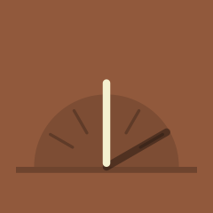

A half dial with the hours marked and a lit pointer in the middle. Its shadow tells the hour of morning and evening.

### The sunflower

A young sunflower follows the sun from rise to set, so it keeps both the morning and the evening. Its seed head is lit.

Reused: the site's mark (src/lib/mark.ts), at emblem size.

### Ten around one

«كُنّ له مسلحة من أول النهار إلى آخره». The ten morning tahlil stand around the one who said them, like a guard, until evening.

Reused: the bead ring the cards once drew for a count of ten or fewer.

### The climbing light

Bars of light fanning up from the earth's edge, from flat to standing, each brighter than the last: the sun climbing through the morning.

Reused: the waking emblem that First light replaced.

### The keep

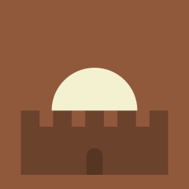

A battlemented wall with the sun on it. The morning adhkar keep the one who says them until evening, and the evening adhkar until morning.

From the content: «وكان في حرز من الشيطان حتى يمسي» (لا إله إلا الله وحده).

### The hourglass

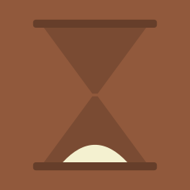

The day turns over like an hourglass, once at morning and once at evening. The lit sand is what the day has gathered. «أصبحنا وأصبح الملك لله».

### The master of istighfar

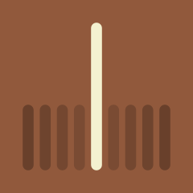

A row of bars, the tallest lit in the middle: «سيد الاستغفار».

### The arc of the sun

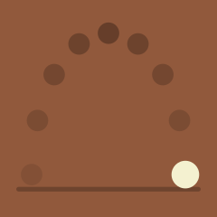

Nine places of the sun on its arc from east to west, the lit one at the horizon: the morning adhkar at the day's start, the evening adhkar at its end.

### Upright

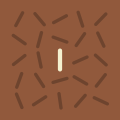

A grid of strokes, each leaning its own way, and one lit stroke standing straight. «أصبحنا على فطرة الإسلام».

## الأذان والمسجد (`masjid`)

### The call

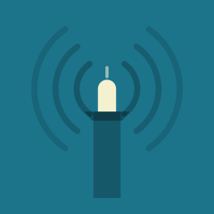

A minaret, with the adhan going out from its top in rings of sound. The call starts at the lit lantern.

### The lamp in the mihrab

The qibla niche with a lamp hanging in it. The light is inside, and the reader walks toward it.

### The arcade

A row of arches, highest in the middle, like a masjid's front. The middle door is open and lit.

### The dome

A dome on its drum, three small windows below, and a lit crescent on its point: a masjid from far away.

### The first row

«لو يعلم الناس ما في النداء والصف الأول». Rows of worshippers behind the mihrab, the first row lit.

### Light on every side

A lit centre with arms of shade above, below, and to each side. «اللهم اجعل في قلبي نورا», said on the way to the prayer.

### The call and its answer

The muezzin says a phrase and the listener answers with its like, line after line. The last answer is lit. «إجابة المؤذن».

### The drops of wudu

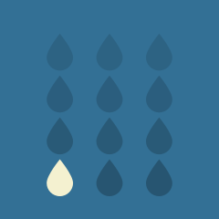

Twelve drops in rows, one limb after another, the last drop lit. Then come «الشهادتان بعد الوضوء».

### The door ajar

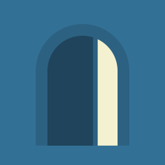

«اللهم افتح لي أبواب رحمتك». An arched door pushed open, and the light through its gap.

## أثناء الصلاة (`fi-al-salah`)

### Standing, bowing, prostrating

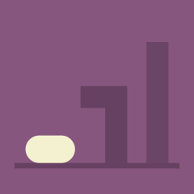

The three postures of a rakʿah, from the right. The prostration is lit: «أقرب ما يكون العبد من ربه وهو ساجد».

### Seven on the ground

«أُمرت أن أسجد على سبعة أعظم». Seven points on the ground: the feet, the knees, the hands, and the lit forehead.

### Toward one centre

Rows around the Kaʿbah from above: squares inside squares, all facing one lit centre.

### East and west

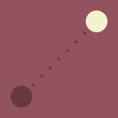

«اللهم باعد بيني وبين خطاياي كما باعدت بين المشرق والمغرب». A dark point and a lit one at opposite corners, dots between them.

### Water, snow, and hail

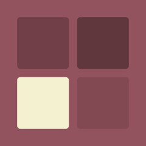

«اللهم اغسل خطاياي بالماء والثلج والبرد». Four squares, each washed lighter than the last, until the fourth is white.

### The circle of the rakʿah

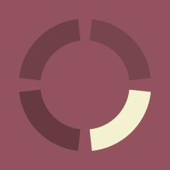

A ring in four arcs: standing, bowing, prostrating, sitting. The prostration is lit, where «سبحان ربي الأعلى» is said.

## بعد الصلاة (`salah`)

### Three rings of beads

سبحان الله، الحمد لله، الله أكبر: thirty three beads on each ring. The lit middle bead makes the hundred.

### Three pillars and a lintel

Three equal columns for the three thirty threes, and one lit beam across them: the لا إله إلا الله that completes them.

### Counted on the fingers

«رأيت النبي ﷺ يعقد التسبيح بيمينه». A hand with the joints of each finger, the counted joint lit.

### Ninety nine seeds

Ninety nine dots in the spiral of a sunflower head, the site's mark, in three shades of thirty three. The hundredth is the lit middle seed.

### Five times

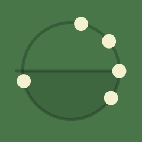

The circle of a day and night, the night half darker, with the five prayers lit on it.

From the occasion's name: أدبار الصلوات, after every prayer.

### The count ring

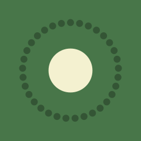

One ring of thirty three beads, the tasbih count, drawn as the site draws a count. The lit centre is where a card puts the number.

Reused: the bead ring the cards once drew for a count, with thirty three beads.

### The hundredth closes the circle

Ninety nine marks around a circle, the three thirty threes, and one lit mark at the top that closes it.

From the content: تمام المئة, the لا إله إلا الله that completes the hundred.

### Ahead

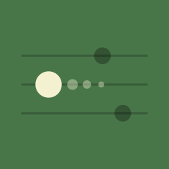

Three lanes, the lit one ahead. A few words after each prayer, and the one who says them overtakes those before.

From the content: «تدركون من كان قبلكم، وتسبقون من جاء بعدكم» (التسبيح عشرًا).

### Three thirds

A ring in three shades of thirty three, and the lit centre: «تمام المئة».

### Salam to the right and the left

Arcs going out to both sides of a lit centre: the taslim, then «اللهم أنت السلام، ومنك السلام».

### Three times

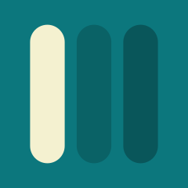

Three tall bars, the third lit: «أستغفر الله» three times, the first words after the salam.

### Remembrance, thanks, and worship

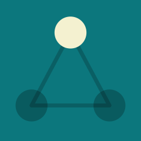

«اللهم أعني على ذكرك وشكرك وحسن عبادتك». Three circles bound in a triangle, the top one lit.

## عند النوم (`nawm`)

### The closing eye

«باسمك اللهم أموت وأحيا». A closed eyelid with lashes, under a small moon. A pair with the opening eye.

### Night comes down

«والليل إذا يغشى». Bands of dark coming down the sky, each lighter than the one above, and a crescent low in the last light.

### Lying down

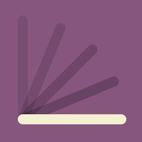

«باسمك رب وضعت جنبي». Five bars fan from standing to lying, the lying one lit. A pair with Rising.

### Leaning

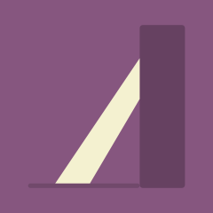

«وألجأت ظهري إليك». A lit slab rests against a wall that does not move.

### Four graces

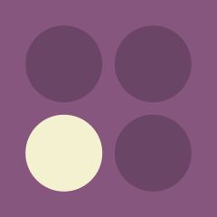

«الحمد لله الذي أطعمنا وسقانا، وكفانا وآوانا». Four circles, the last one, the shelter, lit.

### I die and I live

«باسمك اللهم أموت وأحيا». A curve goes down into the night and up again, with the lit point at its depth.

## عند الاستيقاظ (`istiqaz`)

### The opening eye

«الحمد لله الذي أحيانا بعد ما أماتنا». An open eye with a lit pupil. A pair with the closing eye.

### The window opens

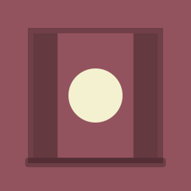

A window with its shutters pushed open, and the lit sun of the new day behind.

### Three knots

«يعقد الشيطان على قافية رأس أحدكم ثلاث عقد». A cord with three knots. Remembering Allah on waking loosens the first, lit and open.

### Rising

«الحمد لله الذي أحيانا بعد ما أماتنا». Five bars fan from lying to standing, the standing one lit. A pair with Lying down.

### The soul returned

«الحمد لله الذي عافاني في جسدي، ورد علي روحي». A broken ring, and the lit point that closes it.

### A window at night

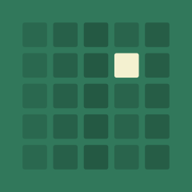

A grid of dark windows and one lit: «من تعار من الليل» and remembered Allah.

### First light

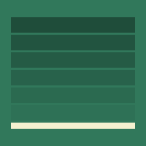

Bands of night, lighter as they go down, and the first lit line at the horizon.

## كل وقت (`mutlaq`)

### Without end

A loop that never closes, for remembrance at any hour. The faint track is always there; the lit line walks it.

### The eight-pointed star

Two squares, one turned, make the eight-pointed star of Islamic patterns. Their overlap darkens, with the lit centre in it.

### Waves

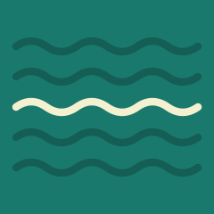

Lines that rise and fall and go on, like a tongue moist with remembrance. The middle one is lit.

### A moist tongue

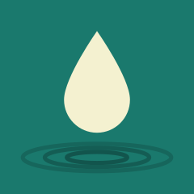

«لا يزال لسانك رطبا من ذكر الله». One lit drop and the rings it leaves below: remembrance again and again.

### A palm in Paradise

A date palm, its trunk in rings, its fronds lit. Each saying plants a palm.

From the content: «غُرست له نخلة في الجنة» (سبحان الله العظيم وبحمده).

### Heavy on the scale

Two words light on the tongue, and the lit pan that holds them sinks. The other pan rises empty.

From the content: «خفيفتان على اللسان، ثقيلتان في الميزان». Reused: the balance drawn for ما لم يثبت, turned the other way.

### A treasure

A treasury's arched door, a chest inside, and a lit jewel over it: six words kept like a treasure.

From the content: «كنز من كنوز الجنة» (لا حول ولا قوة إلا بالله).

### What remains

Four lit squares for the four words that remain, and two fading rings of dots around them: what the sun rises over, which passes.

From the content: الباقيات الصالحات, «أحبّ إليّ مما طلعت عليه الشمس». سبحان الله، والحمد لله، ولا إله إلا الله، والله أكبر.

### One into many

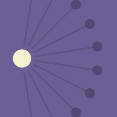

One lit point and ten rays from it, each ending in a dot. From the content: «يكتب له ألف حسنة» for a hundred tasbih.

### Any hour

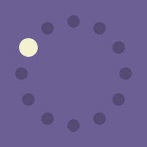

Twelve dots around a ring, the lit one is now. Remembrance at any time has no hour.

## المواسم والحج (`mawasim`)

### The new moon

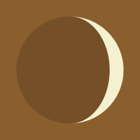

«اللهم أهله علينا باليمن والإيمان». A full moon in shade, and its thin lit edge.

### Seven runs

Two hills at the sides and seven lines between them, the seventh lit: the saʿy between الصفا and المروة.

### The mount

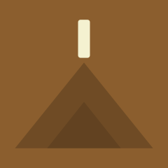

The day of Arafah: a mountain with a lit pillar on its top. «لا إله إلا الله وحده لا شريك له».

### The last ten nights

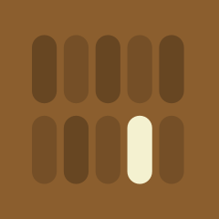

Ten nights in two rows, and one lit, not known which. «اللهم إنك عفو تحب العفو فاعف عني».

### The thirst is gone

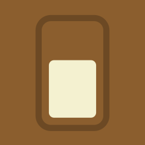

«ذهب الظمأ، وابتلت العروق». A vessel outlined in shade, filled with light at the fast's breaking.

## الطعام والشراب (`taam`)

### A bowl and dates

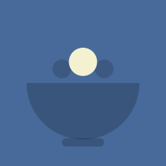

A bowl, two dates beside it, and a lit date above. It was the emblem of «الطعام والشراب» until November 2026.

### Its first and its last

A bar with a dark point at each end, and a lit arc over it from end to start: «بسم الله في أوله وآخره».

### The first fruit

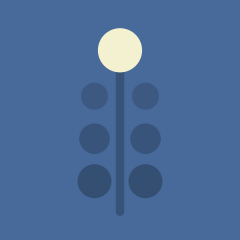

A stem with fruit on both sides, and the first fruit lit at its top: the dua on seeing the first fruit.

### Barakah spreads

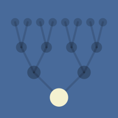

«اللهم بارك لنا فيه وزدنا منه». One lit point at the root, then two, four, and eight.

### Feed who fed me

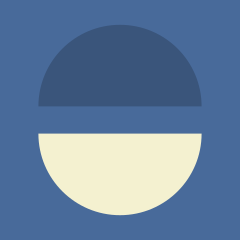

«اللهم أطعم من أطعمني وأسق من أسقاني». Two vessels facing each other, the lower one lit: what is given comes back.

## البيت والأهل (`bayt`)

### The new garment

«الحمد لله الذي كساني هذا الثوب». Folded garments in a pile, the new one lit on top.

### A ring around the children

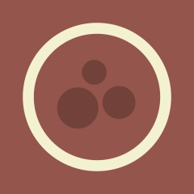

«أعوذ بكلمات الله التامة، من كل شيطان وهامة». A lit ring around three small circles.

### Joined

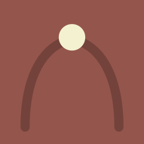

«بارك الله لك، وبارك عليك، وجمع بينكما في خير». Two paths meeting at a lit point.

## الخروج والسفر (`safar`)

### The winding road

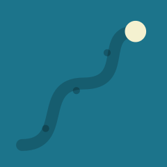

A winding road with three stops, and a lit traveler at its end. It was the emblem of «الخروج والسفر» until November 2026.

### The deposit

«أستودع الله دينك وأمانتك وخواتيم عملك». Three things kept inside a lit frame.

### Coming home

«آيبون تائبون عابدون لربنا حامدون». Four steps, each higher than the one before, the fourth lit.

### The halt

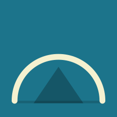

«أعوذ بكلمات الله التامات من شر ما خلق», said on stopping at a place: a lit dome over a tent.

## الناس والمجالس (`nas`)

### The meeting

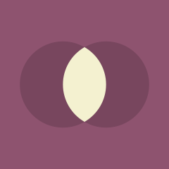

Two circles that meet, with the lit space they share. It was the emblem of «الناس والمجالس» until November 2026.

### The bond

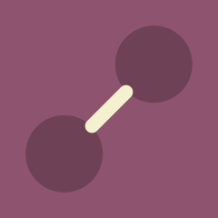

«إني أحبك في الله». Two circles joined by a lit bar.

### The circle of a gathering

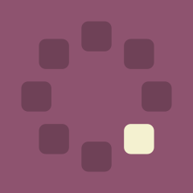

Eight seats in a ring, and the lit one is who stood and said «كفارة المجلس».

### The sneeze and its reply

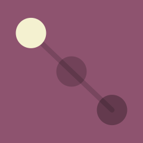

«الحمد لله», then «يرحمك الله», then «يهديكم الله ويصلح بالكم»: three circles in a line, each answering the one before, the last lit.

### A favour returned

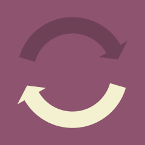

Two arrows in a circle, the returning one lit: a favour goes, and «جزاك الله خيرا» comes back.

## الهم والغضب (`hamm`)

### Relief

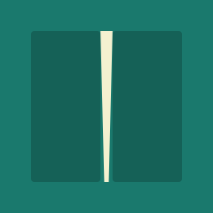

Two heavy walls, with a lit opening between them. It was the emblem of «الهم والغضب» until November 2026.

### Sufficient

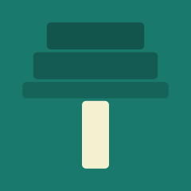

«حسبنا الله ونعم الوكيل». Heavy blocks carried by one lit pillar.

### A fork in the road

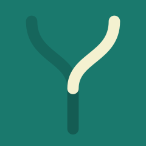

One road becomes two, and one of them is lit: «دعاء الاستخارة».

### In every state

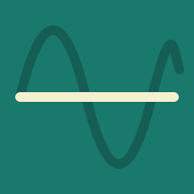

«الحمد لله على كل حال». A wave rises and falls, and a lit straight line runs through it.

### The spring of the heart

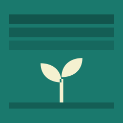

«أن تجعل القرآن ربيع قلبي، ونور صدري، وجلاء حزني». A lit sprout under heavy bands.

### Anger calms

«أعوذ بالله من الشيطان الرجيم» in anger: a sharp line that settles into a lit straight one.

## المرض والرقية (`marad`)

### The pulse

A lit pulse across faint lines. It was the emblem of «المرض والرقية» until November 2026.

### Mended

«شفاء لا يغادر سقما». A ring of twelve parts, and the lit one is the last to heal.

### Where it hurts

«أعوذ بالله وقدرته من شر ما أجد وأحاذر». A place on the body, ringed in light.

### Purified

«لا بأس، طهور إن شاء الله». A lit square, and small squares falling away from it.

## الجنائز (`janaiz`)

### Layers of earth

Layers of earth, darker as they go down, with a lit resting place. It was the emblem of «الجنائز» until November 2026.

### To Him we return

«إنا لله وإنا إليه راجعون». A ring that starts at a lit point and comes back to it.

### The highest companion

«وألحقني بالرفيق الأعلى». Dots rising from the earth, the highest lit.

### The abodes

«السلام عليكم أهل الديار من المؤمنين والمسلمين». Rows of graves, and the visitor's lit path between them.

## المطر والريح (`matar`)

### Slanted rain

Rain in slanted strokes, with one lit drop. It was the emblem of «المطر والريح» until November 2026.

### Around us

«اللهم حوالينا ولا علينا». Rain all around, and a dry lit circle in the middle.

### Beneficial rain

«اللهم صيبا نافعا». Rain falling into a lit pool.

### The wind

Three gusts that curl at their ends, the middle one lit. «اللهم إني أسألك خيرها».

## الجمعة (`jumuah`)

### The five hours

«فكأنما قرب بدنة … فكأنما قرب بيضة». Five circles on the ground, from the largest to the smallest, the first lit: the hours of going early to the prayer, from the camel to the egg.

Retired: the first emblem of الجمعة, which the owner called boring.

### The twelve hours

«فالتمسوها آخر ساعة بعد العصر». The twelve hours of Friday as a fan over the horizon, darkening toward evening, the last lit.

Retired: the second emblem of الجمعة.

### Draw near

«احضروا الذكر وادنوا من الإمام». Rows as arcs around the minbar, the nearest lit.

### The minbar

«يقرؤها كل يوم جمعة على المنبر إذا خطب الناس». A minbar of three steps, its seat lit.

### The best of days

«خير يوم طلعت عليه الشمس يوم الجمعة». Seven suns on the horizon, the largest in the middle lit.

### The light of the cave

«أضاء له من النور ما بين الجمعتين». A dark mountain with a lit cave at its foot.

### Others follow

«فالناس لنا فيه تبع، اليهود غدا، والنصارى بعد غد». Three days in a row, Friday lit first, then Saturday and Sunday.

### The perfume drop

«أو يمس من طيب بيته». A round flask with one lit drop above it. The owner liked the idea and found the drop heavy, which led to the stopper.

### Two garments

«ما على أحدكم لو اشترى ثوبين ليوم الجمعة سوى ثوب مهنته». The work garment dark, and the Friday one beside it lit.

### The first names

«يكتبون الأول فالأول». The angels' sheet of names, the first name lit, the fold at the foot.

### Two khutbahs

«يخطب خطبتين يقعد بينهما». Two standing khutbahs, and the sitting between them lit.

### The brief hour

«وأشار بيده يقللها». The circle of the day, with a short lit piece near its end.

### The perfume shelf

«أو يمس من طيب بيته». Three bottles on a shelf, the round one in the middle lit with its drop.

### The faceted bottle

«وأن يمس طيبا إن وجد». A faceted attar bottle whose stopper is a lit drop.

### The censer

«أو يمس من طيب بيته». A censer on its stand, its smoke rising lit.

### Rising scent

«وأن يمس طيبا إن وجد». A round bottle with two lines of scent above it, the upper lit.

### The lit face

«وأن يمس طيبا إن وجد». A bottle of three faces, the light on one face only.

### A thread of scent

«أو يمس من طيب بيته». An open round bottle, a thin lit thread of scent rising from it.

### A thread of smoke

«أو يمس من طيب بيته». A censer with a thin lit thread of smoke.

## الطب النبوي (`tibb`)

### A third for breath

«فثلث لطعامه، وثلث لشرابه، وثلث لنفسه». A vessel in three thirds, the breath lit.

### Seven dates

«من تصبح كل يوم سبع تمرات عجوة». Seven around a ring, the seventh lit.

### Three breaths

«كان يتنفس في الشراب ثلاثا». A cup with three arcs over it, the third lit.

## أحوال متفرقة (`ahwal`)

### The compass

Every state has its dhikr: travel, rain, entering, leaving. An eight-point compass, its needle lit toward the way ahead.

### Nine states

Nine small, different forms, like the states of a day: going out, coming in, rain, a meal, a journey. The middle door is lit.

### The open door

«بسم الله ولجنا، وبسم الله خرجنا». A door open on a lit room, its light on the floor. Going out and coming in are the most common states of a day.

### A ring of keys

A ring of keys, one for each door of the day. The key in hand is lit: the dhikr for the present state.

From the occasion's groups: the house, the market, the road, the meal, and more.

### The road

A road to the horizon, the sun at its end. Every step of a journey has its dhikr: setting out, the climb, the descent, arriving, and coming home.

From the content: السفر, one of the occasion's two largest groups.

### Cloud and rain

A lit cloud with rain under it. The weather turns, and each turn has its dhikr.

From the content: «اللهم صيبا نافعا» (المطر), and the group of the crescent, the wind, and the rain.

### Out and back

A house, and a lit path that leaves and returns: the two moments repeated most in a day.

From the content: «فيقال له: حسبك، قد هُديت وكُفيت ووُقيت» (الخروج من المنزل).

### Turning roads

A grid of turning roads, with one lit path across it. It was the emblem of «أحوال متفرقة» until the section was divided in November 2026.

## ما لم يثبت (`unproven`)

### The open link

A chain of narration with one link open and out of line. A dhikr is as strong as its chain's weakest link.

### The balance

A tipping scale: the lit pan rises because its load weighs nothing. al-Albani's ruling weighs each narration.

### The sieve

Narrations pass through a sieve. The small sound ones fall through, and the lit one stays on top: it did not pass.

### The hollow one

Nine circles: eight solid, one lit but hollow. From far away it looks like the others, and it holds nothing.
