# Emblem ideas

This page keeps the emblems we drew in November 2026 and did not choose. A new occasion can take one instead of starting from nothing. There are 49. Each sits under the occasion we drew it for, on that occasion's color, but none of them belongs to it now.

Every one keeps the rules of the set: a square of 240 units, flat geometric shapes, black shade at low opacity, and one lit shape in full eggshell (`src/lib/palette.ts`). Each drawing here is a still frame in `docs/emblem-ideas/`. The code that drew them is gone.

To use one:

1. Draw it again in `src/lib/emblems.ts`, and mark the lit shape with its `enter`. Only the lit shape moves (see [`code-conventions.md`](code-conventions.md), "Motion").
2. Check each quote in its idea against the content of the occasion it goes to. Every quote here comes from the site's content files, but a new occasion may not hold that dhikr.
3. Run `bun run opengraph` and `bun run opengraph:adhkar`, because the sharing cards draw the emblems.
4. Remove it from this page.

## أذكار الصباح والمساء (`sabah-masaa`)

### The horizon

One sun on the line of the horizon, with its reflection in four bands below. The same picture is a sunrise and a sunset, so it holds both the morning and the evening.

### Both ends of the day

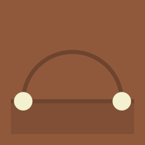

«قبل طلوع الشمس وقبل غروبها». The path of the sun over the horizon, with a light at each end: the rising and the setting.

### Night and day

«يقلب الله الليل والنهار». One disc, half lit and half dark, inside a faint ring. The day and the night follow each other, and both have their adhkar.

### The sundial

A half dial with the hours marked on it and a lit pointer standing in the middle. Its shadow tells the hour of the morning and of the evening.

### The sunflower

A young sunflower faces the sun as it rises and follows it until it sets, so it keeps the morning and the evening both. Its seed head is lit.

Reused: the site’s own mark (src/lib/mark.ts), drawn at emblem size.

### Ten around one

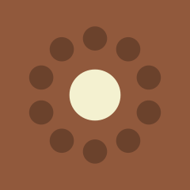

«كُنّ له مسلحة من أول النهار إلى آخره». The ten tahlil of the morning stand around the one who said them, like a guard, until the evening.

Reused: the ring of beads that shows a count of ten or fewer on every card (src/lib/beads.ts).

### The climbing light

Bars of light fanning up from the edge of the earth, from lying flat to standing, each brighter than the last: the sun climbing through the morning.

Reused: the waking emblem that First light replaced. It was always a sunrise in shape.

### The keep

A wall with its battlements and the sun sitting on it. The adhkar of the morning keep the one who says them safe until the evening, and those of the evening until the morning.

From the content: «وكان في حرز من الشيطان حتى يمسي» (لا إله إلا الله وحده، in this occasion).

## أذكار الأذان والمسجد (`masjid`)

### The call

A minaret, with the adhan going out from its top in rings of sound. The lit lantern at the top is where the call starts.

### The lamp in the mihrab

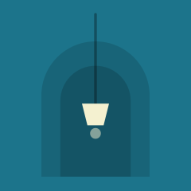

The niche of the qibla with a lamp hanging in it. The light is inside the masjid, and the reader walks toward it.

### The arcade

A row of arches, highest in the middle, like the front of a masjid. The middle door is open and lit.

### The dome

A dome on its drum, three small windows below, and a lit crescent on its point. The plainest picture of a masjid from far away.

### The first row

«لو يعلم الناس ما في النداء والصف الأول». Rows of worshippers behind the mihrab, and the first row lit.

## أذكار داخل الصلاة (`fi-al-salah`)

### Standing, bowing, prostrating

The three postures of a rakʿah, read from the right. The prostration is lit: «أقرب ما يكون العبد من ربه وهو ساجد».

### Seven on the ground

«أُمرت أن أسجد على سبعة أعظم». Seven points resting on the ground: the feet, the knees, the hands, and the forehead, which is lit.

### Toward one centre

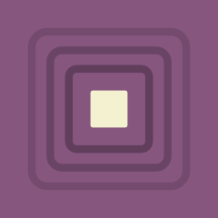

Rows around the Kaʿbah seen from above: squares inside squares, all facing one lit centre. Every prayer turns to it.

## أذكار أدبار الصلوات (`salah`)

### Three rings of beads

سبحان الله، الحمد لله، الله أكبر: thirty three beads on each ring. The lit bead in the middle is the one that makes the hundred.

### Three pillars and a lintel

Three equal columns for the three thirty threes, and one lit beam across their tops: the لا إله إلا الله that completes them.

### Counted on the fingers

«رأيت النبي ﷺ يعقد التسبيح بيمينه». A hand with the joints of each finger. The joint being counted is lit.

### Ninety nine seeds

Ninety nine dots set in the spiral of a sunflower head, the mark of the site, in three shades of thirty three. The hundredth is the lit seed in the middle.

### Five times

The circle of a day and a night, the night half darker, with the five prayers lit on it: the dawn, the noon, the afternoon, the sunset, and the night.

From the name of the occasion: أدبار الصلوات, after every prayer.

### The count ring

One ring of thirty three beads, the count of the tasbih, drawn the way the site already draws a count. The lit centre is where the number stands on a card.

Reused: the ring of beads that shows each count on the site (src/lib/beads.ts), with thirty three beads.

### The hundredth closes the circle

Ninety nine marks around a circle, the three thirty threes, and one lit mark at the top that closes it.

From the content: تمام المئة, the لا إله إلا الله that completes the hundred.

### Ahead

Three lanes, and the lit one is ahead of the rest. A few words after each prayer, and the one who says them overtakes those who came before.

From the content: «تدركون من كان قبلكم، وتسبقون من جاء بعدكم» (التسبيح عشرًا).

## أذكار النوم (`nawm`)

### The closing eye

«باسمك اللهم أموت وأحيا». A closed eyelid with its lashes, under a small moon. A pair with the opening eye.

### Night comes down

«والليل إذا يغشى». Bands of dark coming down from the top of the sky, each one lighter than the one above it, and a crescent low in the last light.

## أذكار الاستيقاظ (`istiqaz`)

### The opening eye

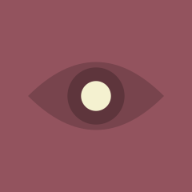

«الحمد لله الذي أحيانا بعد ما أماتنا». An open eye, the lit pupil in its middle. A pair with the closing eye.

### The window opens

A window with its shutters pushed open, and the lit sun of the new day behind them.

### Three knots

«يعقد الشيطان على قافية رأس أحدكم ثلاث عقد». A cord with three knots. Remembering Allah on waking loosens the first, and it is lit and open.

## أذكار عامة (`mutlaq`)

### Without end

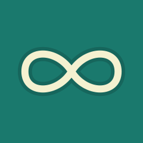

A loop that never closes off, for remembrance at any hour. The faint track is always there; the lit line is the one walking it.

### The eight-pointed star

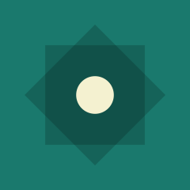

Two squares, one turned, make the eight-pointed star of Islamic patterns. Where they overlap, the middle darkens, and the lit centre sits in it.

### Waves

Lines that rise and fall and keep going, like the tongue that stays moist with remembrance. The middle one is lit.

### A moist tongue

«لا يزال لسانك رطبا من ذكر الله». One lit drop, and the rings it leaves below. Remembrance at any time, again and again.

### A palm in Paradise

A date palm: its trunk in rings, its fronds lit. Each time the words are said, a palm is planted.

From the content: «غُرست له نخلة في الجنة» (سبحان الله العظيم وبحمده).

### Heavy on the scale

Two words, light on the tongue, and the lit pan that holds them sinks. The other pan rises empty.

From the content: «خفيفتان على اللسان، ثقيلتان في الميزان». Reused: the balance drawn for ما لم يثبت, turned the other way.

### A treasure

The arched door of a treasury, a chest inside it, and a lit jewel over the chest. Six words that are kept like a treasure.

From the content: «كنز من كنوز الجنة» (لا حول ولا قوة إلا بالله).

### What remains

Four lit squares for the four words that remain, and around them two rings of dots that fade: the things the sun rises over, which pass.

From the content: الباقيات الصالحات, «أحبّ إليّ مما طلعت عليه الشمس». سبحان الله، والحمد لله، ولا إله إلا الله، والله أكبر.

## أذكار الأحوال (`ahwal`)

### The compass

Every state has its dhikr: travel, rain, entering, leaving. A compass with eight points, its needle lit toward the way ahead.

### Nine states

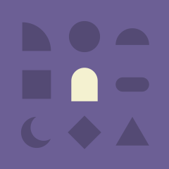

Nine different small forms, as many and as different as the states of a day: going out, coming in, rain, a meal, a journey. The door in the middle is lit.

### The open door

«بسم الله ولجنا، وبسم الله خرجنا». A door standing open on a lit room, with its light falling on the floor. Going out and coming in are the most common states of a day.

### Rain

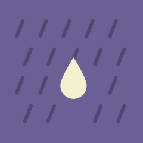

«اللهم صيبا نافعا». Rain falling in slanted strokes, with one lit drop among them. Rain stands for all the states that come and go.

### A ring of keys

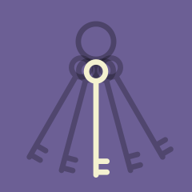

A ring of keys, one for each door of the day. The key in your hand now is lit: the dhikr for the state you are in.

From the groups of this occasion: the house, the market, the road, the meal, and more.

### The road

A road running to the horizon, with the sun at its end. Every journey here has its dhikr: setting out, the climb, the descent, arriving, and coming home.

From the content: السفر, one of the two largest groups of this occasion.

### Cloud and rain

A lit cloud with its rain falling under it. The weather turns, and each turn has its dhikr.

From the content: «اللهم صيبا نافعا» (المطر), and the group of the crescent, the wind, and the rain.

### Out and back

A house, and a lit path that leaves it and turns back to it. Going out and coming home are the two moments repeated most in a day.

From the content: «فيقال له: حسبك، قد هُديت وكُفيت ووُقيت» (الخروج من المنزل).

## ما لم يثبت (`unproven`)

### The open link

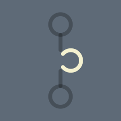

A chain of narration with one link opened and out of line. A dhikr is only as strong as the weakest link of its chain.

### The balance

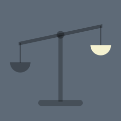

A scale that tips: the lit pan rises because what is in it does not weigh. The ruling of al-Albani weighs each narration.

### The sieve

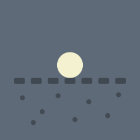

Narrations pass through a sieve of verification. The small sound ones fall through, and the lit one is held back on top: it did not pass.

### The hollow one

Nine circles: eight solid, and one lit but hollow. It looks like the others from far away and has nothing inside it.
