# Emblem ideas

The 48 emblems drawn in November 2026 and not chosen, and one retired, so a new occasion can take one instead of starting from nothing. Each sits under the occasion it was drawn for, on that occasion's color, but belongs to none now.

Each keeps the rules of the set: a 240-unit square, flat geometric shapes, black shade at low opacity, and one lit shape in full eggshell (`src/lib/palette.ts`). Each drawing is a still frame in `docs/emblem-ideas/`. The code that drew them is gone.

To use one:

1. Draw it again in `src/lib/emblems.ts`, and mark the lit shape with its `enter`. Only the lit shape moves ([`code-conventions.md`](code-conventions.md#motion)).
2. Check each quote against the content of its new occasion. Every quote comes from the site's content, but a new occasion may not hold that dhikr.
3. Run `bun run opengraph` and `bun run opengraph:adhkar`, because the cards draw the emblems.
4. Remove it from this page.

## الصباح والمساء (`sabah-masaa`)

### The horizon

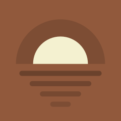

One sun on the horizon, with its reflection in four bands below. The picture is both a sunrise and a sunset.

### Both ends of the day

«قبل طلوع الشمس وقبل غروبها». The sun's path over the horizon, lit at each end: the rising and the setting.

### Night and day

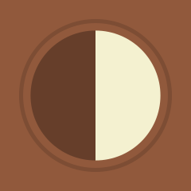

«يقلب الله الليل والنهار». One disc, half lit and half dark, in a faint ring. Day and night follow each other, and both have their adhkar.

### The sundial

A half dial with the hours marked and a lit pointer in the middle. Its shadow tells the hour of morning and evening.

### The sunflower

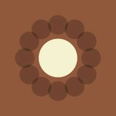

A young sunflower follows the sun from rise to set, so it keeps both the morning and the evening. Its seed head is lit.

Reused: the site's mark (src/lib/mark.ts), at emblem size.

### Ten around one

«كُنّ له مسلحة من أول النهار إلى آخره». The ten morning tahlil stand around the one who said them, like a guard, until evening.

Reused: the bead ring that shows a count of ten or fewer on every card (src/lib/beads.ts).

### The climbing light

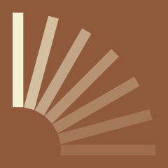

Bars of light fanning up from the earth's edge, from flat to standing, each brighter than the last: the sun climbing through the morning.

Reused: the waking emblem that First light replaced.

### The keep

A battlemented wall with the sun on it. The morning adhkar keep the one who says them until evening, and the evening adhkar until morning.

From the content: «وكان في حرز من الشيطان حتى يمسي» (لا إله إلا الله وحده).

## الأذان والمسجد (`masjid`)

### The call

A minaret, with the adhan going out from its top in rings of sound. The call starts at the lit lantern.

### The lamp in the mihrab

The qibla niche with a lamp hanging in it. The light is inside, and the reader walks toward it.

### The arcade

A row of arches, highest in the middle, like a masjid's front. The middle door is open and lit.

### The dome

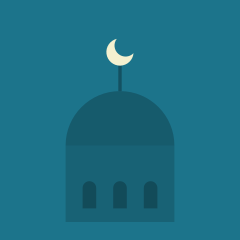

A dome on its drum, three small windows below, and a lit crescent on its point: a masjid from far away.

### The first row

«لو يعلم الناس ما في النداء والصف الأول». Rows of worshippers behind the mihrab, the first row lit.

## أثناء الصلاة (`fi-al-salah`)

### Standing, bowing, prostrating

The three postures of a rakʿah, from the right. The prostration is lit: «أقرب ما يكون العبد من ربه وهو ساجد».

### Seven on the ground

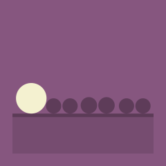

«أُمرت أن أسجد على سبعة أعظم». Seven points on the ground: the feet, the knees, the hands, and the lit forehead.

### Toward one centre

Rows around the Kaʿbah from above: squares inside squares, all facing one lit centre.

## بعد الصلاة (`salah`)

### Three rings of beads

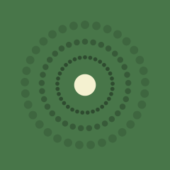

سبحان الله، الحمد لله، الله أكبر: thirty three beads on each ring. The lit middle bead makes the hundred.

### Three pillars and a lintel

Three equal columns for the three thirty threes, and one lit beam across them: the لا إله إلا الله that completes them.

### Counted on the fingers

«رأيت النبي ﷺ يعقد التسبيح بيمينه». A hand with the joints of each finger, the counted joint lit.

### Ninety nine seeds

Ninety nine dots in the spiral of a sunflower head, the site's mark, in three shades of thirty three. The hundredth is the lit middle seed.

### Five times

The circle of a day and night, the night half darker, with the five prayers lit on it.

From the occasion's name: أدبار الصلوات, after every prayer.

### The count ring

One ring of thirty three beads, the tasbih count, drawn as the site draws a count. The lit centre is where a card puts the number.

Reused: the bead ring of each count (src/lib/beads.ts), with thirty three beads.

### The hundredth closes the circle

Ninety nine marks around a circle, the three thirty threes, and one lit mark at the top that closes it.

From the content: تمام المئة, the لا إله إلا الله that completes the hundred.

### Ahead

Three lanes, the lit one ahead. A few words after each prayer, and the one who says them overtakes those before.

From the content: «تدركون من كان قبلكم، وتسبقون من جاء بعدكم» (التسبيح عشرًا).

## عند النوم (`nawm`)

### The closing eye

«باسمك اللهم أموت وأحيا». A closed eyelid with lashes, under a small moon. A pair with the opening eye.

### Night comes down

«والليل إذا يغشى». Bands of dark coming down the sky, each lighter than the one above, and a crescent low in the last light.

## عند الاستيقاظ (`istiqaz`)

### The opening eye

«الحمد لله الذي أحيانا بعد ما أماتنا». An open eye with a lit pupil. A pair with the closing eye.

### The window opens

A window with its shutters pushed open, and the lit sun of the new day behind.

### Three knots

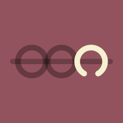

«يعقد الشيطان على قافية رأس أحدكم ثلاث عقد». A cord with three knots. Remembering Allah on waking loosens the first, lit and open.

## كل وقت (`mutlaq`)

### Without end

A loop that never closes, for remembrance at any hour. The faint track is always there; the lit line walks it.

### The eight-pointed star

Two squares, one turned, make the eight-pointed star of Islamic patterns. Their overlap darkens, with the lit centre in it.

### Waves

Lines that rise and fall and go on, like a tongue moist with remembrance. The middle one is lit.

### A moist tongue

«لا يزال لسانك رطبا من ذكر الله». One lit drop and the rings it leaves below: remembrance again and again.

### A palm in Paradise

A date palm, its trunk in rings, its fronds lit. Each saying plants a palm.

From the content: «غُرست له نخلة في الجنة» (سبحان الله العظيم وبحمده).

### Heavy on the scale

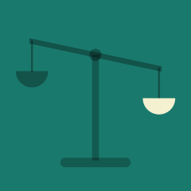

Two words light on the tongue, and the lit pan that holds them sinks. The other pan rises empty.

From the content: «خفيفتان على اللسان، ثقيلتان في الميزان». Reused: the balance drawn for ما لم يثبت, turned the other way.

### A treasure

A treasury's arched door, a chest inside, and a lit jewel over it: six words kept like a treasure.

From the content: «كنز من كنوز الجنة» (لا حول ولا قوة إلا بالله).

### What remains

Four lit squares for the four words that remain, and two fading rings of dots around them: what the sun rises over, which passes.

From the content: الباقيات الصالحات, «أحبّ إليّ مما طلعت عليه الشمس». سبحان الله، والحمد لله، ولا إله إلا الله، والله أكبر.

## أحوال متفرقة (`ahwal`)

### The compass

Every state has its dhikr: travel, rain, entering, leaving. An eight-point compass, its needle lit toward the way ahead.

### Nine states

Nine small, different forms, like the states of a day: going out, coming in, rain, a meal, a journey. The middle door is lit.

### The open door

«بسم الله ولجنا، وبسم الله خرجنا». A door open on a lit room, its light on the floor. Going out and coming in are the most common states of a day.

### A ring of keys

A ring of keys, one for each door of the day. The key in hand is lit: the dhikr for the present state.

From the occasion's groups: the house, the market, the road, the meal, and more.

### The road

A road to the horizon, the sun at its end. Every step of a journey has its dhikr: setting out, the climb, the descent, arriving, and coming home.

From the content: السفر, one of the occasion's two largest groups.

### Cloud and rain

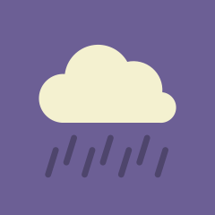

A lit cloud with rain under it. The weather turns, and each turn has its dhikr.

From the content: «اللهم صيبا نافعا» (المطر), and the group of the crescent, the wind, and the rain.

### Out and back

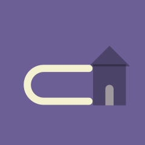

A house, and a lit path that leaves and returns: the two moments repeated most in a day.

From the content: «فيقال له: حسبك، قد هُديت وكُفيت ووُقيت» (الخروج من المنزل).

### Turning roads

A grid of turning roads, with one lit path across it. It was the emblem of «أحوال متفرقة» until the section was divided in November 2026.

## ما لم يثبت (`unproven`)

### The open link

A chain of narration with one link open and out of line. A dhikr is as strong as its chain's weakest link.

### The balance

A tipping scale: the lit pan rises because its load weighs nothing. al-Albani's ruling weighs each narration.

### The sieve

Narrations pass through a sieve. The small sound ones fall through, and the lit one stays on top: it did not pass.

### The hollow one

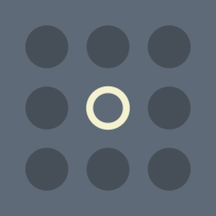

Nine circles: eight solid, one lit but hollow. From far away it looks like the others, and it holds nothing.
